<div align="center">

# 🧠 AI Python Mentor

### AI-powered platform for learning Python and backend development

[](https://github.com/Coffee1337/ai-python-mentor/actions/workflows/ci.yml)

**FastAPI · Next.js · PostgreSQL · RAG · Docker**

</div>

---

---

## 📸 Screenshots

Реальные снимки из браузерного прогона (`npx playwright test`, Chromium 153, 1440×900),
не макеты.

| Экран | Скриншот |
|---|---|
| Лендинг | 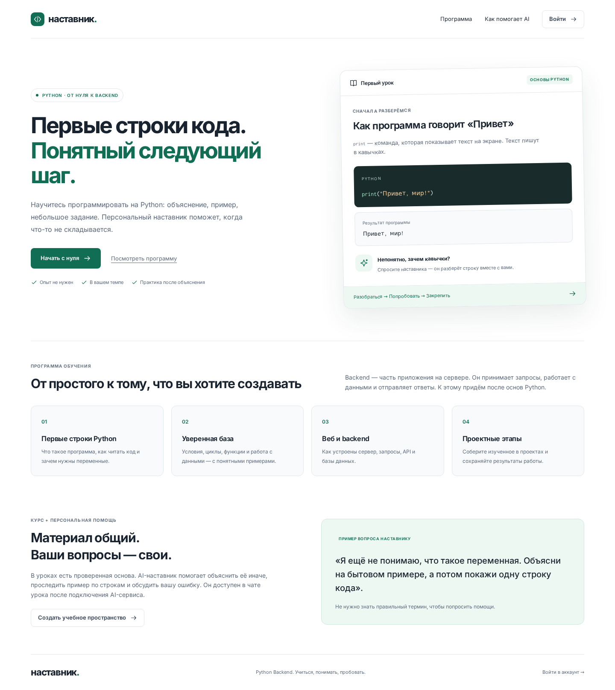 |
| Онбординг | 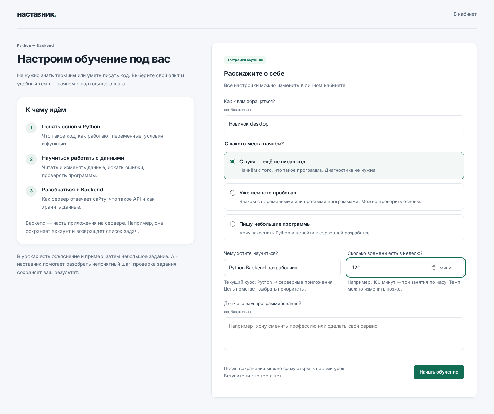 |
| Урок | 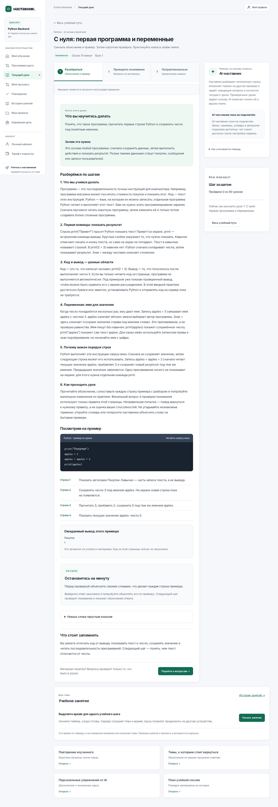 |
| Практика | 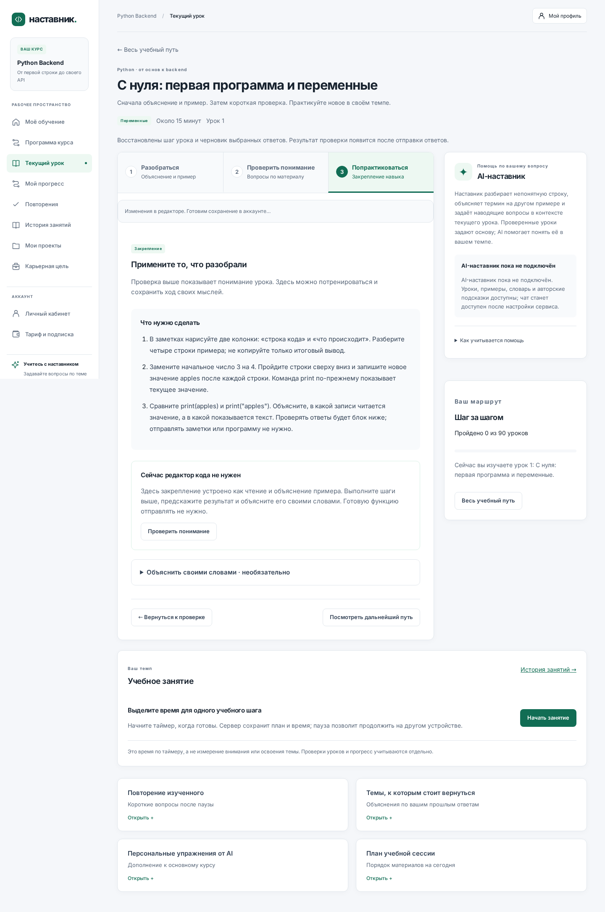 |
| Дашборд «На сегодня» | 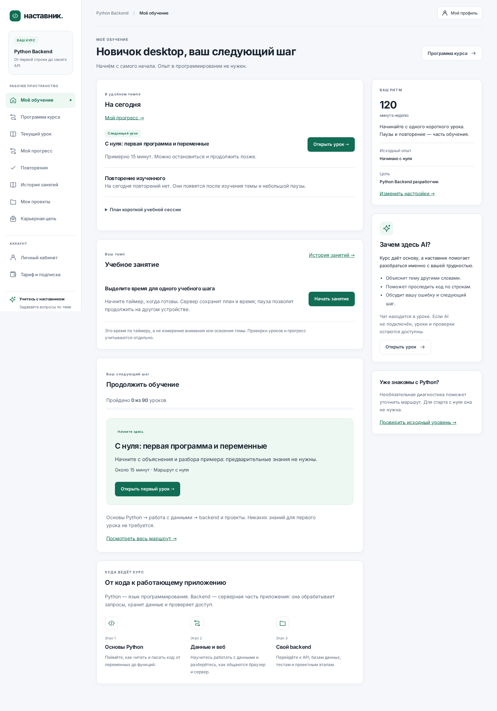 |
| Карта курса | 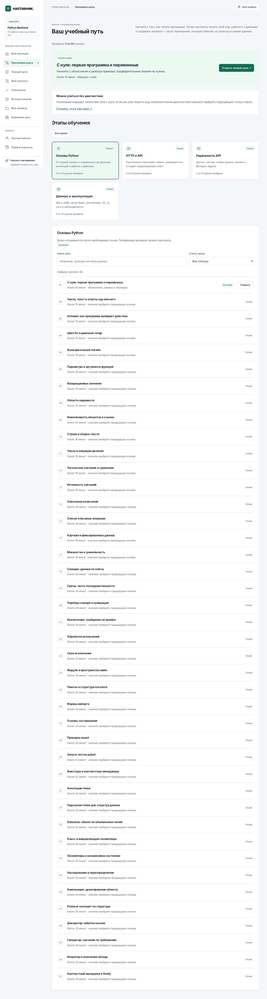 |
| Прогресс | 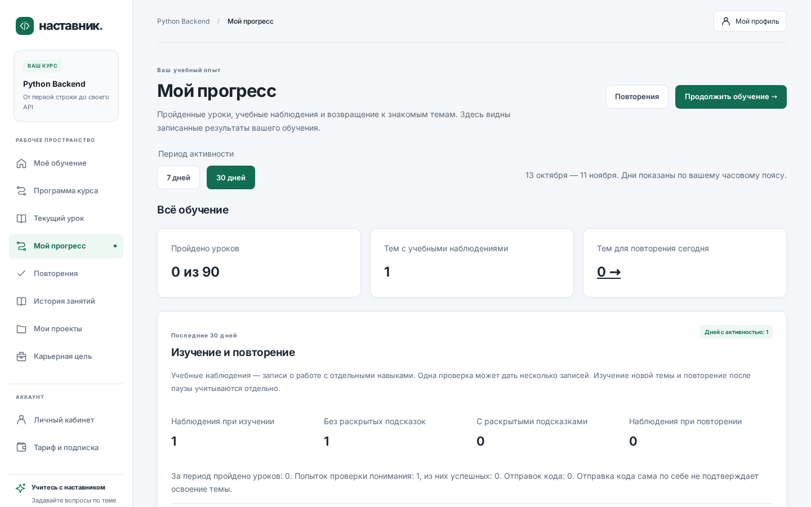 |
| Повторения | 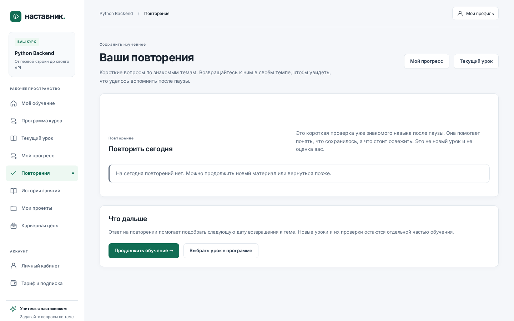 |
| Проекты | 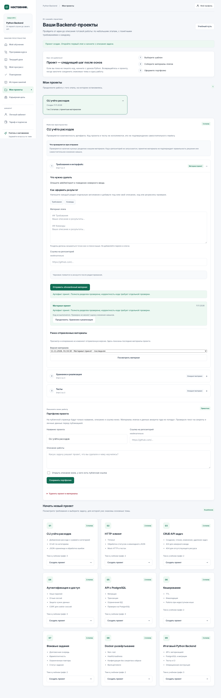 |
| Публичное портфолио | 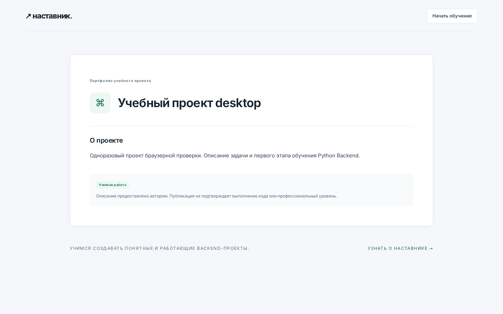 |
| Диагностика | 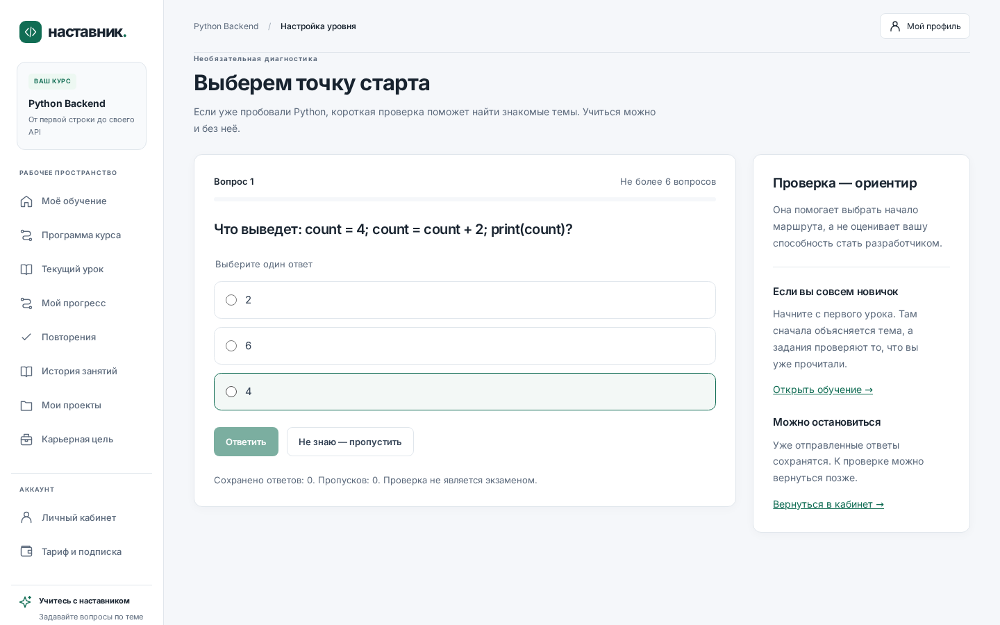 |

## ✨ Overview

AI Python Mentor — full-stack приложение для изучения Python с нуля до backend-разработки.

Платформа объединяет:

- структурированную программу обучения;
- практические Python-задания;
- AI-наставника;
- персональный roadmap;
- систему прогресса и повторений;
- анализ вакансий и skill gaps;
- проектную практику;
- Telegram-интеграцию.

Проект построен как production-oriented система с отдельными backend/frontend слоями, PostgreSQL, миграциями, фоновой обработкой задач, CI и изолированной архитектурой исполнения пользовательского Python-кода.

---
## 🚧 Project Status

**Работающий продукт, идёт подготовка релиза v1.0.0.**

Что проверено командами, а не заявлено:

| Область | Команда | Результат |
|---|---|---|
| API-тесты | `cd apps/api && python -m pytest -q` | 350 passed, 10 skipped (5:49) |
| PostgreSQL-набор | `RUN_POSTGRES_TESTS=1 pytest tests/test_postgres_specific.py` | 7 passed |
| Исполнение кода | `python -m unittest apps.runner.tests.test_exercise_catalog` | 90 заданий, 288 кейсов, эталоны 100 % |
| Изоляция runner | `python -m unittest apps.runner.tests.test_landlock_sandbox` | 15 тестов: сеть, ФС, fork, exec, сигналы, CPU/RAM/вывод |
| Браузерные сценарии | `cd scripts/ui-smoke && npx playwright test` | 8 passed (desktop + mobile) |
| Исполнение кода в браузере | `EXECUTION_E2E=1 npx playwright test execution.spec.mjs` | 2 passed: решение ученика считается 3 из 3 в runner |
| Веб | `cd apps/web && npm run lint && npm run build` | зелёные |
| Линтеры | `ruff check apps scripts` | All checks passed |
| Миграции | `alembic upgrade head` / `downgrade` на PostgreSQL 16 | обратимы, данные сохраняются |
| Бэкап и restore | `scripts/backup.sh`, `scripts/restore-drill.sh` | 0.7 c / 3.2 c, digests совпали |
| AI-контур | `scripts/ai-smoke.py` | живые ответы RU+EN, 3–8 c, стоимость в логах |
| Нагрузка | `k6 run scripts/load/learning.js` | p95 = 76 ms, 0 % ошибок, 27.9 req/s (10 VU) |

Ограничения, которые нельзя обойти на сборочной машине: здесь нет Docker и root, поэтому
`compose.prod.yml` проверен структурно, а контейнерный бэкенд runner (runsc + cgroups v2) —
только unit-тестами. Живой прогон — на целевом хосте по `docs/RUNBOOK.md`.
Матрица трассировки спеки: `docs/SPEC-MATRIX.md`, аудит дефектов: `docs/AUDIT.md`,
статус: `docs/STATUS.md`, безопасность: `docs/SECURITY-ASVS.md`.

---

## 🚀 Key Features

### 🎓 Learning Platform

- 90 учебных навыков и уроков;
- обучение от Python basics до backend;
- knowledge checks и quiz;
- практические задания;
- система подсказок;
- spaced repetition;
- персонализированный learning roadmap;
- отслеживание прогресса и mastery.

### 🤖 AI Tutor

- AI-чат с учебным контекстом;
- локальный RAG по актуальной версии урока;
- разбор ошибок и пользовательского кода;
- AI-feedback для письменных заданий;
- ограничение AI usage;
- учёт использования и стоимости AI-вызовов.

### 💻 Python Practice

Каждое практическое задание использует контракт:

```python
def solve(payload):
    ...
```

Система поддерживает:

- публичные примеры;
- скрытые тесты;
- сохранение решений;
- историю попыток;
- асинхронную постановку выполнения в очередь.

Исполнение пользовательского кода вынесено за пределы основного API и проектируется как отдельный защищённый Runner.

---

## 🏗 Architecture

```text
                        ┌──────────────────┐
                        │     Browser      │
                        └────────┬─────────┘
                                 │
                                 ▼
                        ┌──────────────────┐
                        │     Next.js      │
                        │     Frontend     │
                        └────────┬─────────┘
                                 │
                                 ▼
┌───────────────┐       ┌──────────────────┐       ┌─────────────────┐
│   Telegram    │──────▶│     FastAPI      │◀─────▶│   PostgreSQL    │
└───────────────┘       │       API        │       └─────────────────┘
                        └────────┬─────────┘
                                 │
                 ┌───────────────┼────────────────┐
                 │               │                │
                 ▼               ▼                ▼
        ┌──────────────┐ ┌──────────────┐ ┌──────────────┐
        │  AI Gateway  │ │ Background   │ │ Python Runner│
        │    + RAG     │ │   Workers    │ │  (isolated)  │
        └──────────────┘ └──────────────┘ └──────────────┘
```

Основное приложение организовано как модульный монолит.

Отдельными процессами могут работать:

- notification dispatcher;
- execution dispatcher;
- Python Runner;
- внешние email / Telegram / billing adapters.

---

## 🛠 Tech Stack

### Backend

- Python 3.12
- FastAPI
- SQLAlchemy
- Alembic
- PostgreSQL
- Pydantic
- Argon2
- AsyncIO

### Frontend

- Next.js 15
- React 19
- TypeScript

### AI

- LLM Gateway
- Retrieval-Augmented Generation
- local knowledge index
- usage quotas
- token / cost accounting

### Infrastructure

- Docker
- Docker Compose
- GitHub Actions
- background workers
- PostgreSQL migrations

### Integrations

- Telegram Bot API
- Email delivery adapter
- Billing adapter
- AI providers

---

## 🔐 Authentication & Security

В приложении реализованы:

- cookie-based sessions;
- Argon2 password hashing;
- CSRF protection;
- email confirmation;
- password reset;
- session revocation;
- account export;
- account deletion;
- audit logging для административных операций.

Production-конфигурация требует HTTPS и secure cookies.

```env
APP_ENV=production
COOKIE_SECURE=true
```

Секреты не должны храниться в Git-репозитории.

---

## 🧠 RAG

AI-наставник использует Retrieval-Augmented Generation для получения контекста из учебных материалов.

Knowledge base строится на основе immutable snapshots опубликованных уроков.

```bash
cd apps/api

python -m app.knowledge_base
```

Это позволяет AI работать с конкретной версией учебного материала, которую изучает пользователь.

---

## 📊 Learning Model

Платформа разделяет несколько показателей прогресса:

```text
Knowledge
Practice
Independence
Retention
```

Результат обучения не определяется только количеством правильных ответов.

Система учитывает:

- знания;
- практическое применение;
- самостоятельность;
- сохранение знаний со временем.

---

## 💼 Career Features

Платформа может анализировать текст вакансии и выделять:

- требования;
- необходимые технологии;
- подтверждающие фрагменты вакансии;
- skill gaps пользователя.

На основе выбранной вакансии learning roadmap может перестраиваться под конкретную карьерную цель.

---

## 📦 Project Practice

В платформу входят шаблоны проектов для портфолио.

Для каждого проекта поддерживаются:

- milestones;
- история артефактов;
- проверка комплектности;
- публикация проекта в портфолио.

---

## ⚡ Quick Start

### Requirements

Для локальной разработки:

```text
Python 3.12
Node.js 22
```

PostgreSQL рекомендуется, но для локального запуска можно использовать SQLite.

---

## 🪟 Windows

### Backend

```powershell
git clone https://github.com/Coffee1337/ai-python-mentor.git
cd ai-python-mentor

powershell -NoProfile -ExecutionPolicy Bypass `
  -File .\scripts\start-api.ps1 `
  -UseSqlite
```

Backend:

```text
http://127.0.0.1:8000
```

Swagger:

```text
http://127.0.0.1:8000/docs
```

Health check:

```text
http://127.0.0.1:8000/ready
```

### Frontend

В новом терминале:

```powershell
cd ai-python-mentor

powershell -NoProfile -ExecutionPolicy Bypass `
  -File .\scripts\start-web.ps1
```

Откройте:

```text
http://localhost:3000
```

---

## 🐧 Linux / macOS

### Backend

```bash
cd apps/api

python3.12 -m venv .venv

.venv/bin/python -m pip install -r requirements.lock

.venv/bin/python ../../scripts/local-api.py --use-sqlite
```

### Frontend

```bash
cd apps/web

npm ci

API_INTERNAL_URL=http://127.0.0.1:8000 \
NEXT_PUBLIC_API_URL=/api \
npm run dev
```

---

## 🐳 Docker (разработка)

```bash
cp .env.example .env
docker compose up -d db
docker compose run --rm api alembic upgrade head
docker compose up -d api web
```

```text
Frontend   http://localhost:3000
API        http://localhost:8000
Swagger    http://localhost:8000/docs
```

Runner и фоновые обработчики включаются профилями: `--profile execution` (исполнение кода)
и `--profile notifications` (письма и Telegram).

## 🚢 Production: одна команда

```bash
git clone https://github.com/coffee1337/ai-python-mentor.git /opt/mentor && cd /opt/mentor
cp .env.prod.example .env.prod && $EDITOR .env.prod      # домен, пароли, ключ AI-шлюза
PYTHONPATH=apps/api python scripts/runner-dev-bootstrap.py /etc/ai-tutor
PYTHONPATH=apps/api python scripts/export-runner-catalog.py /etc/ai-tutor/catalog.json
cp .env.runner.example .env.runner && $EDITOR .env.runner
docker compose -f compose.prod.yml --env-file .env.prod up -d --build
```

Что произойдёт: `db` → `migrate` (alembic upgrade head) → `seed-check` (90 навыков и 90 заданий,
иначе деплой падает) → `api` → `execution-worker`, `notification-worker`, `runner`,
`runner-reaper`, `web`, `caddy` с автоматическим TLS. Наружу открыты только 80/443;
`/metrics` и `/internal/*` снаружи отдают 404.

Проверка и дальнейшие шаги: `curl -fsS https://$DOMAIN/ready`, полный runbook —
`docs/RUNBOOK.md` (деплой, обновление, откат, бэкап, restore drill, реакция на алерты).

---

## ⚙️ Configuration

Пример конфигурации находится в:

```text
.env.example
```

Основные группы настроек:

```text
Database
AI Gateway
Email
Telegram
Billing
Runner
Security
```

Пример AI-конфигурации:

```env
AI_GATEWAY_URL=
AI_GATEWAY_MODEL=
AI_GATEWAY_API_KEY=
```

При отсутствии AI Gateway основная учебная система продолжает работать, а AI-функции становятся недоступными.

---

## 🧪 Testing

Backend:

```bash
cd apps/api

python -m pytest -q
```

PostgreSQL-specific tests:

```bash
RUN_POSTGRES_TESTS=1 \
python -m pytest -q tests/test_postgres_specific.py
```

Проверка миграций:

```bash
alembic check
```

Frontend:

```bash
cd apps/web

npm run lint
npm run build
```

Браузерный CI проверяет путь новичка и основные экраны при 1440×900 и 390×844: восстановление шага/ответов, прогресс и повторения, поиск, сохранение карьерной цели, редактирование отправленных материалов и безопасное восстановление кода, keyboard focus в мобильном меню. Снимки страниц и отчёт доступны в артефакте `browser-ui-desktop-mobile`. Дополнительная QA-зависимость Playwright изолирована в `scripts/ui-smoke`; в bundle приложения она не попадает.

После входа dashboard показывает «На сегодня»; в меню есть «Мой прогресс» (`/learning/progress`), «Повторения» (`/learning/reviews`) и «История занятий» (`/learning/sessions`). Прогресс за 7/30 дней показывает записанные события и отдельно самостоятельные, assisted и retention observations. Поиск программы курса не открывает заблокированные уроки. В проектах можно просмотреть прежнюю отправку и скопировать её в новый черновик; принятие разделов не означает правильность кода. В истории попыток можно вернуть код точной версии текущего упражнения с резервным черновиком.

Шаг урока, неотправленные варианты ответа, код, объяснения и материалы этапов сохраняются в аккаунте. При изменении с двух устройств интерфейс показывает оба варианта и требует явного выбора; предыдущий вариант сохраняется локально перед заменой. При недоступной сети текст остаётся в редакторе и локальном черновике, если browser storage доступен. Выход очищает локальные копии; серверные черновики остаются в аккаунте. Удаление аккаунта удаляет их; удаление проекта удаляет черновики его этапов.

Таймер занятия сохраняет план на момент начала, паузы и время. Скрытие вкладки отправляет паузу; без подтверждения активности сервер ограничивает дальнейший отсчёт одной минутой. Продолжение требует явного действия, а завершение таймера не добавляет освоения темы. [Контракты синхронизации и занятий](docs/study-workspaces.md).

Runner tests:

```bash
python -m unittest discover -s apps/runner/tests -v
```

---

## 🔄 CI

GitHub Actions проверяет:

- backend tests;
- PostgreSQL migrations;
- PostgreSQL-specific tests;
- frontend types;
- frontend build;
- worker logic;
- Windows native startup;
- browser UI flows.

Отдельные проверки выполняются для Windows без Docker.

---

## 🖥 Windows Native Development

Для Windows предусмотрены launcher-скрипты, которые проверяют окружение перед запуском приложения.

В частности проверяются:

- версия Python;
- Node.js;
- установка dependencies;
- доступность базы;
- Alembic migrations;
- запуск FastAPI;
- запуск Next.js;
- регистрация и cookie session;
- сохранение локальных данных.

Это позволяет запускать development environment без Docker.

---

## 🔒 Python Code Execution

Пользовательский Python-код **не выполняется внутри основного API**.

Архитектура предусматривает отдельный execution host.

Для production Runner предполагаются:

- Linux host;
- cgroups v2;
- isolated containers / sandbox;
- resource limits;
- seccomp / AppArmor;
- user namespaces;
- mTLS;
- отдельный execution dispatcher.

По умолчанию выполнение пользовательского кода отключено.

Подробнее:

```text
docs/runner-deployment.md
docs/runner-protocol.md
docs/runner-security-review.md
```

---

## 📂 Project Structure

```text
ai-python-mentor/
│
├── apps/
│   ├── api/             # FastAPI backend
│   ├── web/             # Next.js frontend
│   └── runner/          # isolated Python execution
│
├── docs/                # architecture / deployment docs
├── scripts/             # development and maintenance scripts
├── .github/
│   └── workflows/       # CI
│
├── docker-compose.yml
├── .env.example
└── README.md
```

---

## 📚 Documentation

Дополнительная техническая документация находится в `docs/`.

Особенно:

```text
docs/runner-deployment.md
docs/runner-protocol.md
docs/runner-security-review.md
docs/backup.md
```

Статус реализованных и запланированных компонентов:

```text
UNIMPLEMENTED_STAGES.md
```

---

## 🎯 Project Goals

Проект создаётся как практика разработки сложной full-stack системы с акцентом на:

- backend architecture;
- reliable data processing;
- AI integration;
- security;
- infrastructure;
- testing;
- observability;
- scalable application design.

---

## 👨‍💻 Author

**Egor Trefilov / Coffee1337**

GitHub:  
https://github.com/Coffee1337

Portfolio:  
https://coffee1337.github.io

---

<div align="center">

Built with Python, FastAPI, PostgreSQL, Next.js and AI.

</div>
